# REFLECTIVE JOURNAL

### WEDNESDAY | SETPEMBER 16, 2026
This excercise was the first time I have ever used Markdown. Previously I have used Github, HTML and a bit of JS at my Univsierty back home in Australia, however learning something like Markdown was a great way to get further versed in the world of coding. 

Some things I learned include:
> 1. Structuring a page
> 2. Writing headings in various forms H1, H2, H3
> 3. Bolding and italicising text
> 4. Linking Images and sheets
> 5. Lists (ordered and unordered)
> 6. Setting up an MD sheet in Github

I found this was a great experiment as it furthered my knowledge of Github aswell as Markdown. One thing that surprised me about Markdown was how easy and quick it was to learn (with the cheat sheet). Given how coding can be quite tedious and precise, I was expecting the same for Markdown but I didn't find this. I think that's also a cool aspect of it too, as it makes not only Markdown more accessible to all, but it also helps Github become less intimidtating. That being said, the  thing that I found most difficult was just setting it up in Github for the first time, and configuring an MD sheet, etc. 

When it comes to my work, I aspire to create work that helps people and makes their lives easier, or fun too! I want future audiences to connect with and utlisie my work in the highest capacities.

**Include at least one screenshot (probably just of your website, just for practice).**
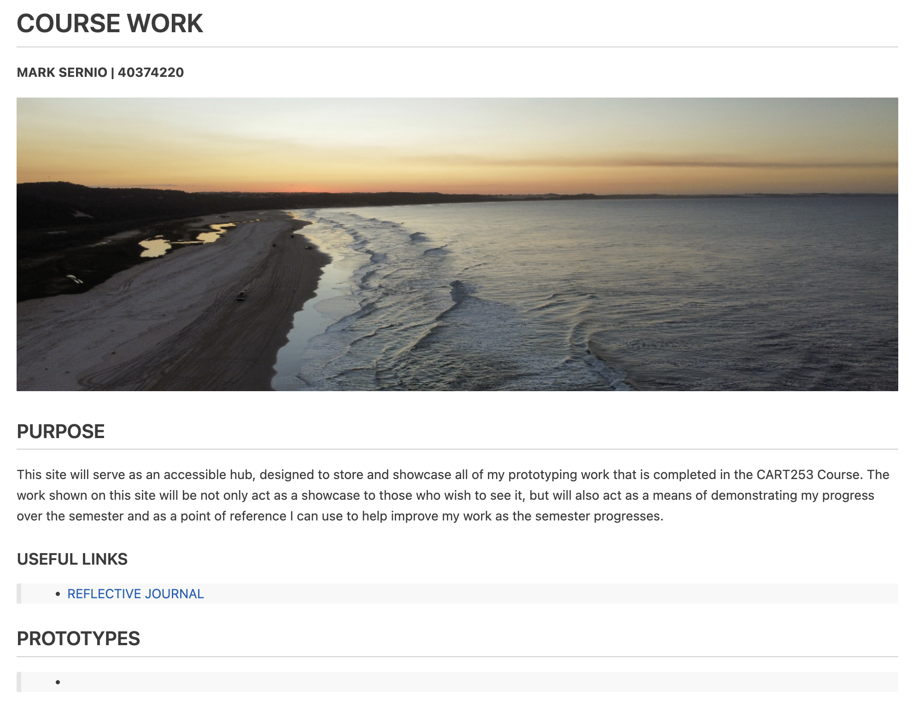

### WEDNESDAY | SETPEMBER 23, 2026
This excercise was one that I found great for developing my knowledge, however I just feel that I didn't produce technically proficient work compared to what level I think we should be at.

Considering we were to use the knowledge we learnt in class and try not to advance too much further, I found completing these prototypes more of an excerise on my design process and how to get creative with the producing designs off basic code learnt. That being said, it was great to repetitavely use the code so that I learnt it more.

I think one thing I found most confusing was the PI functon for rotating the Ellipse's. My goal going forward is to continue to develop my knowledge and start exploring more with P5 and learning some other functions that differ from or extend on what we learnt in class. 

Prototypes:
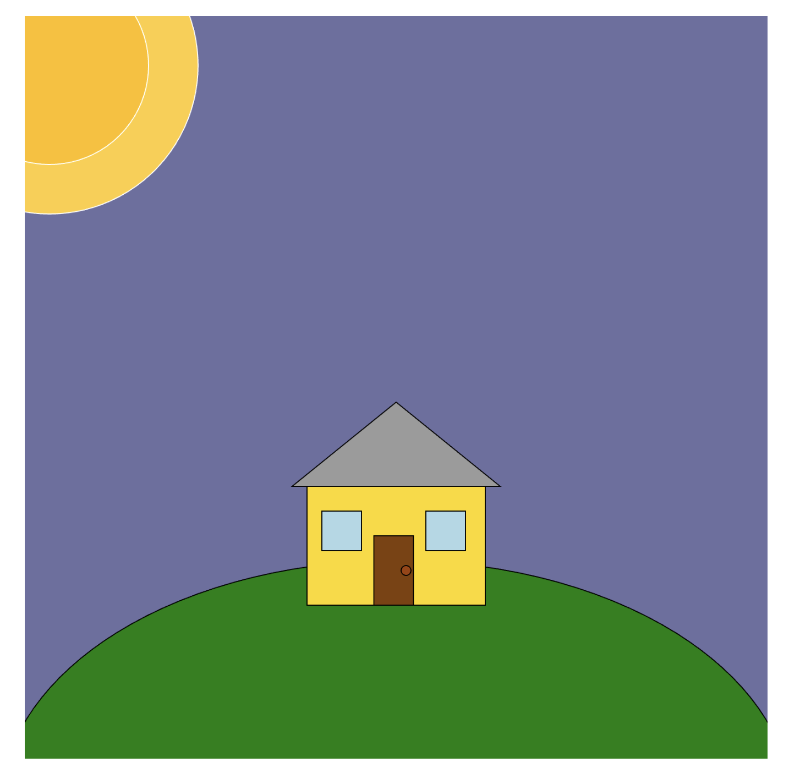
> - [LINK TO PROTOTYPE - REPRESENTATIONAL](TOPICS/PROTOTYPING/ThreePrototypes/P1/)

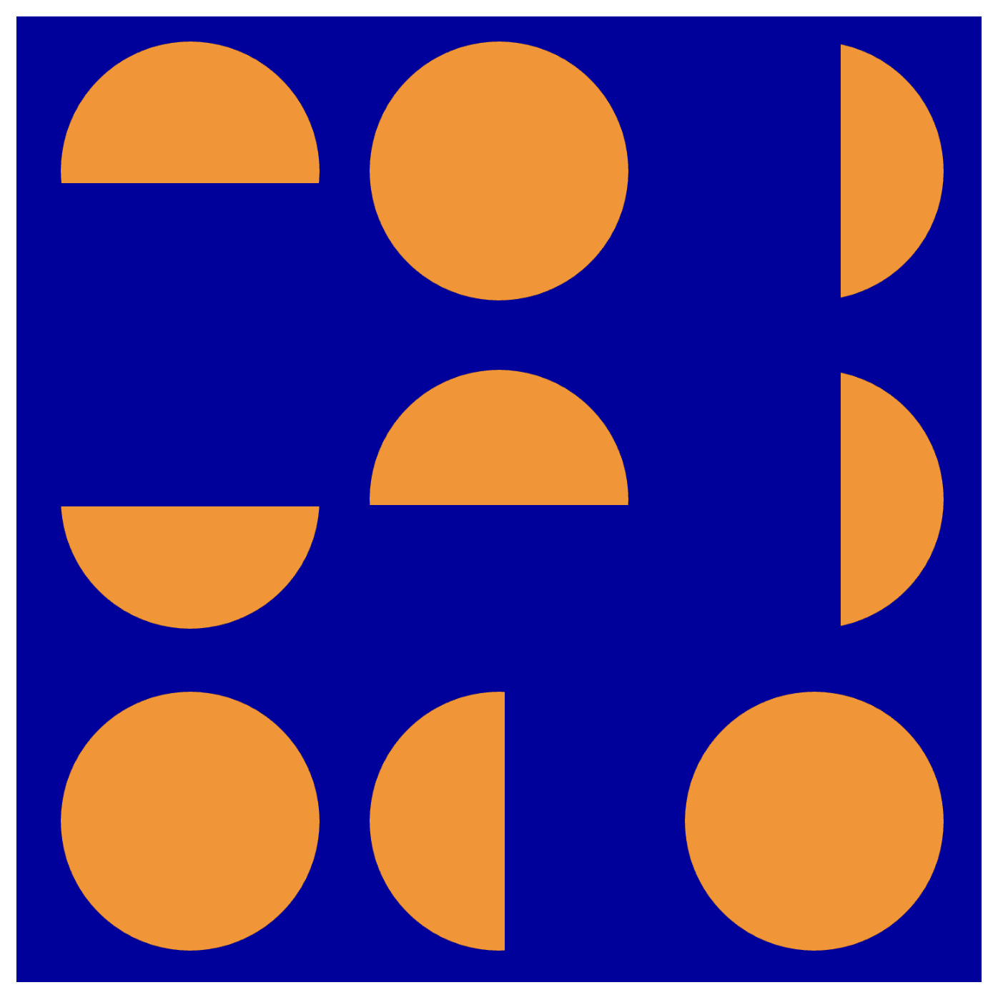
> - [LINK TO PROTOTYPE - ABSTRACT ](TOPICS/PROTOTYPING/ThreePrototypes/P2/)

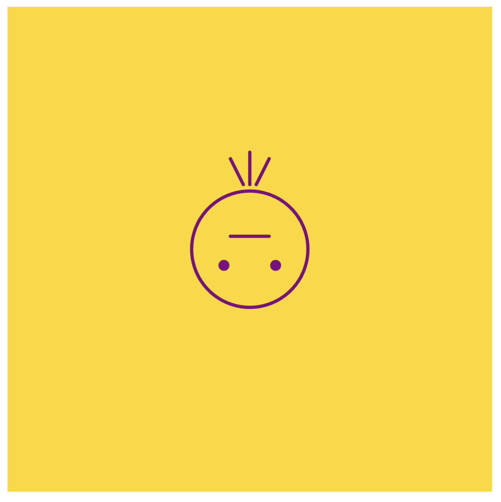
> - [LINK TO PROTOTYPE - WEIRD](TOPICS/PROTOTYPING/ThreePrototypes/P3/)

### WEDNESDAY | SETPEMBER 30, 2026
This excercise was one that I enjoyed because it helped develop confidence in knowledge of a function that I thought would be complex. It's actaully a super helpful function that makes manipulating things easier and faster to manipulate. One thing I initially struggled to understand was how to call the variables and do it correctly. I still find it a bit confusing but I have gotten much more confident with it. I hope in looking at my work, people can see that I tried to experiement with all the things we learnt in the week and showcase each one in each Prototype. I think because of how helpful the Variables function is, that I can develop my knowledge in them further, and make more complex ones as I progress through the semester.

Prototypes:
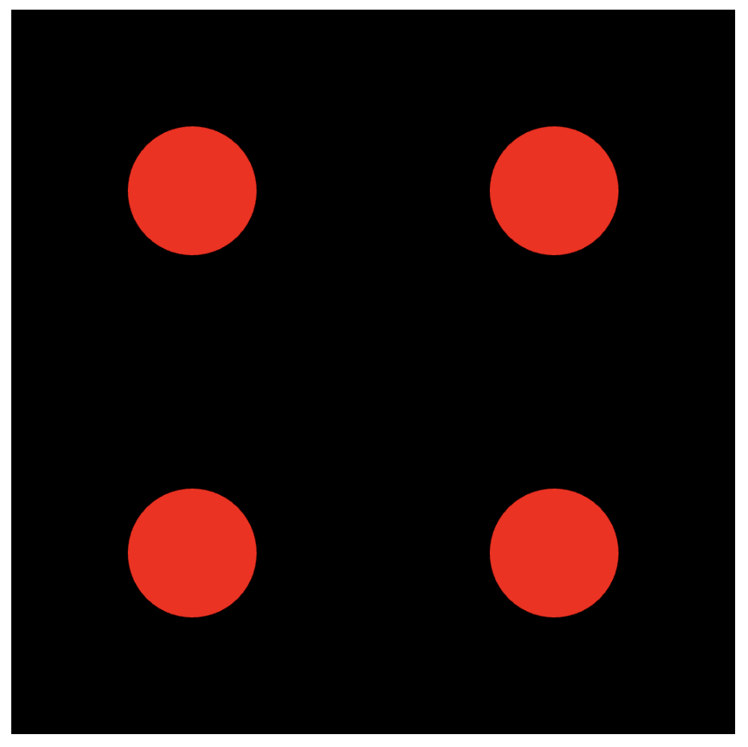
> - [LINK TO PROTOTYPE - 1 VARIABLES](TOPICS/PROTOTYPING/Variables_Prototypes/Variables_p1/)

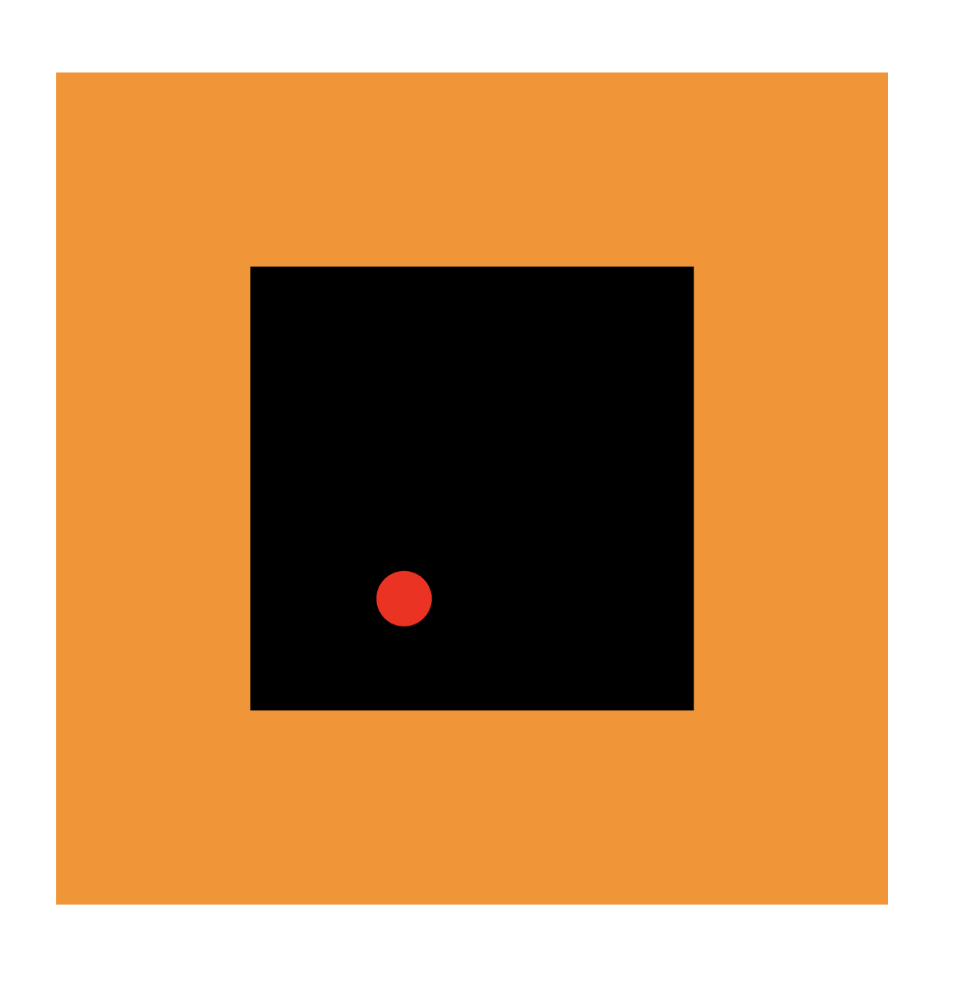
> - [LINK TO PROTOTYPE - 2 VARIABLES](TOPICS/PROTOTYPING/Variables_Prototypes/Variables_p2/)

> - [LINK TO PROTOTYPE - 3 VARIABLES](TOPICS/PROTOTYPING/Variables_Prototypes/Variables_p3/)

### WEDNESDAY | OCTOBER 7, 2026
This week, I struggled a bit with these Prototypes more so in just grasping the concept of conditionals and how to write them, and link them with the variables. I think one thing I really struggled with was the math side of it, and calculating/coding a formula to work out things like Distance and Distance from mouse to the shape I wanted to effect, etc. That being said, when I finally got it to work, I was happy with what I produced as an exhibit of what we learnt from class, and I think going forward, 'Conditionals' will be a very benefical concept to utilise in the future. I still think I will struggle to use it, but with continued practice I know it will help.

Prototypes:

> - [LINK TO PROTOTYPE - 1 CONDITIONALS](TOPICS/PROTOTYPING/Conditional_Prototypes/conditionals_p1/)

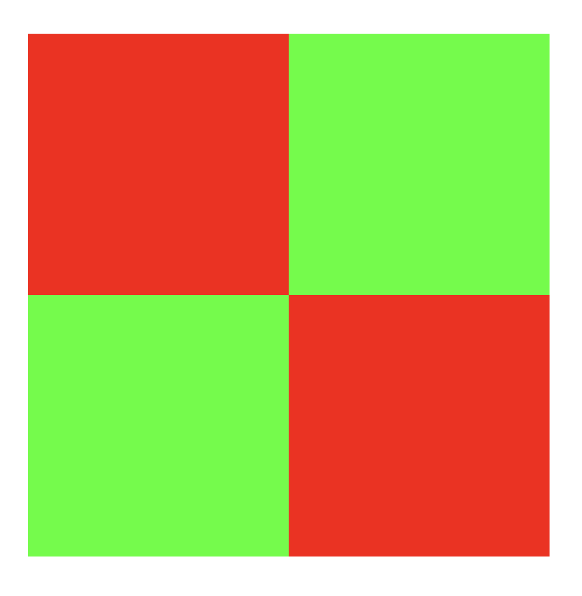
> - [LINK TO PROTOTYPE - 2 CONDITIONALS](TOPICS/PROTOTYPING/Conditional_Prototypes/conditionals_p2/)

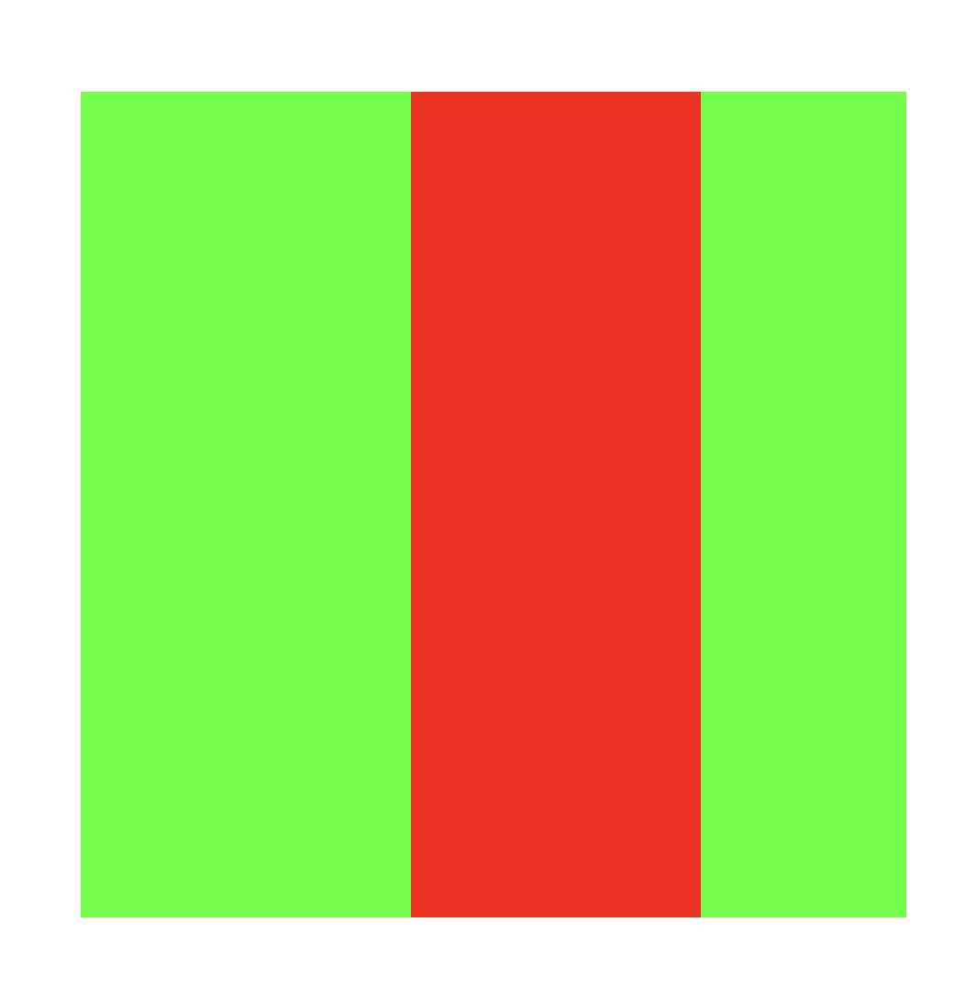
> - [LINK TO PROTOTYPE - 3 CONDITIONALS](TOPICS/PROTOTYPING/Conditional_Prototypes/conditionals_p3/)

### FRIDAY | OCTOBER 23, 2026
This week we we learnt about Events and how to utilise them within our own code to make a program respond to external input. 

Across my three prototypes I used a timer (setInterval), key presses (keyPressed), the mouse wheel (mouseWheel) and mouse clicks (mousePressed), and combined them with variables and conditionals from earlier weeks. In the Hungry Plant, a timer shrinks the plant while key presses feed it, and an if/else chain changes its colour with its hunger. In the Sky Scroller - which I reworked from my Prototype 1 in our variables Week - scrolling moves the sun and the sky colour follows it. Then finally, the Typing Paint draws entirely from events and doesn't need draw() at all.

The biggest thing I learnt is that events run once per action, unlike checking something every frame in draw(). That made things like toggling a colour on click much more reliable. Events also made my programs feel more alive, because they only act when the user does something. It made it feel like you have more control on how the code can work, but how it can be specific to each users experience too. It certainly something I will continue to adapt and develop going forward.

Prototypes:
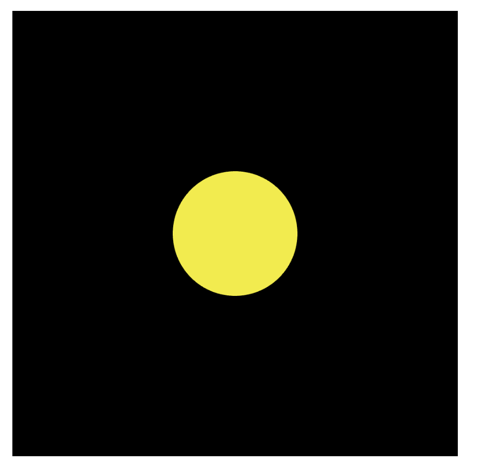
> - [LINK TO PROTOTYPE - 1 EVENTS](TOPICS/PROTOTYPING/Events_Prototypes/events_p1/)

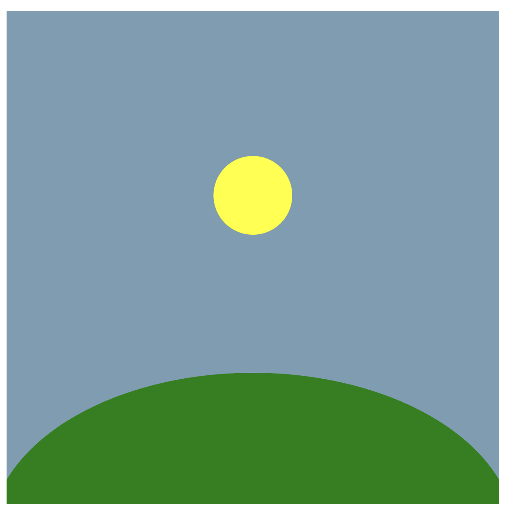
> - [LINK TO PROTOTYPE - 2 EVENTS](TOPICS/PROTOTYPING/Events_Prototypes/events_p2/)

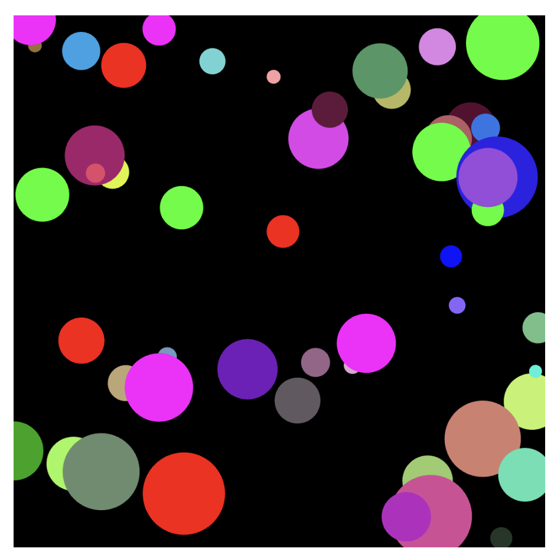
> - [LINK TO PROTOTYPE - 3 EVENTS](TOPICS/PROTOTYPING/Events_Prototypes/events_p3/)

### FRIDAY | OCTOBER 30, 2026
This week the three prototypes revolved around the topic of functions. I made a board of buttons that set each other off, three circles that react in size and colour to the movement of the mouse, and a flower whose petals fall off when clicked.

I think what surprised me most was how much code could actually be refactored, and how much it condensed the repetition. My first prototype had a mousePressed() of about 70 lines because I copied the same click check four times. Once I wrote isInside(button), toggleButton(button) and drawButton(button), it shrank to about 15 lines and looked identical, which I can see why is helpful.

One thing I found cool is that functions can make things, not just do things. createPetal() returns a whole object, and changing one number, the angle, gives me six different petals around a flower. Even getCloseness() which returns a number that other functions use to change a circle’s size and colour.

In terms of challenges, I did struggle with 'return' and where variables live. I got an error because I built newShape inside a function but never declared shape1 outside it to catch the result. Continuously attempting to use and research it helped me successfully implament it, but I still think that is something I will struggle with going forward.

I’d like to develop the flower further. I wrote petal1 to petal6 out by hand, and the repetition showed me why arrays exist which we are doing this week in class, so rebuilding it as a list of petals is a natural next step.

Prototypes:
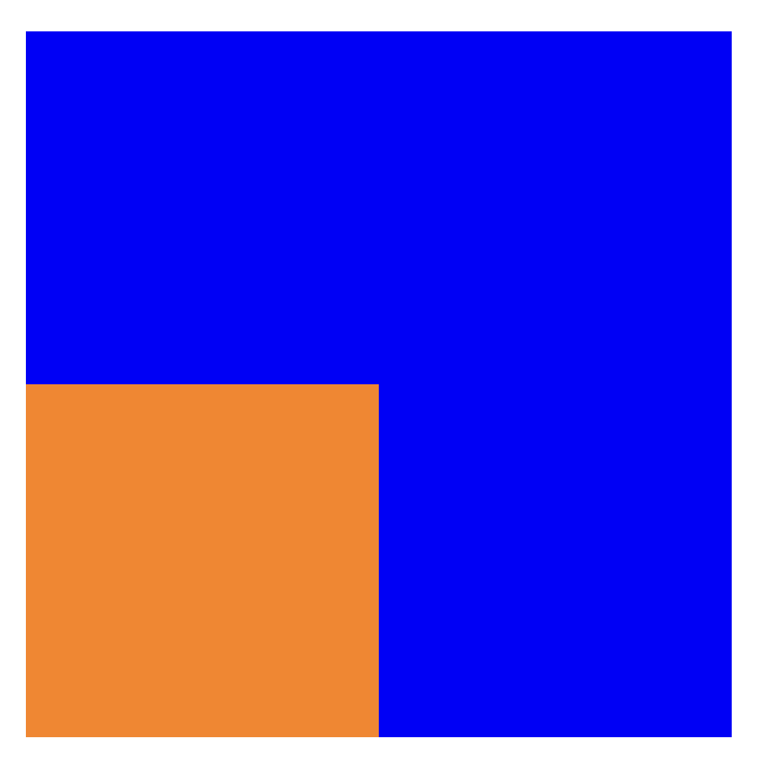
> - [LINK TO PROTOTYPE - 1 FUNCTIONS](TOPICS/PROTOTYPING/Functions_Prototypes/functions_p1/)

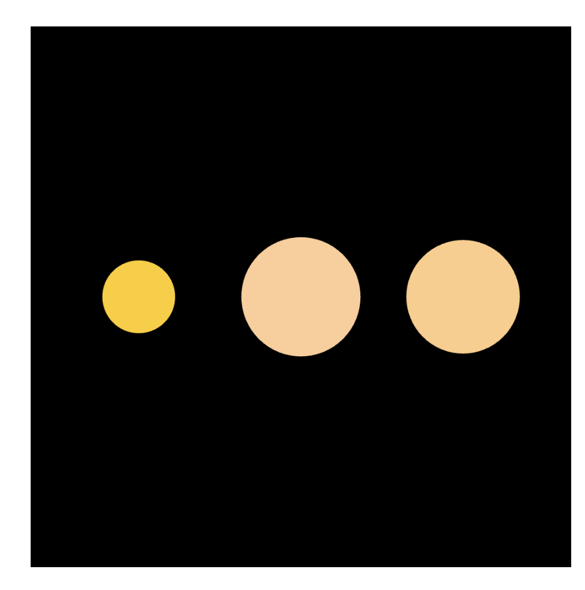
> - [LINK TO PROTOTYPE - 2 FUNCTIONS](TOPICS/PROTOTYPING/Functions_Prototypes/functions_p2/)

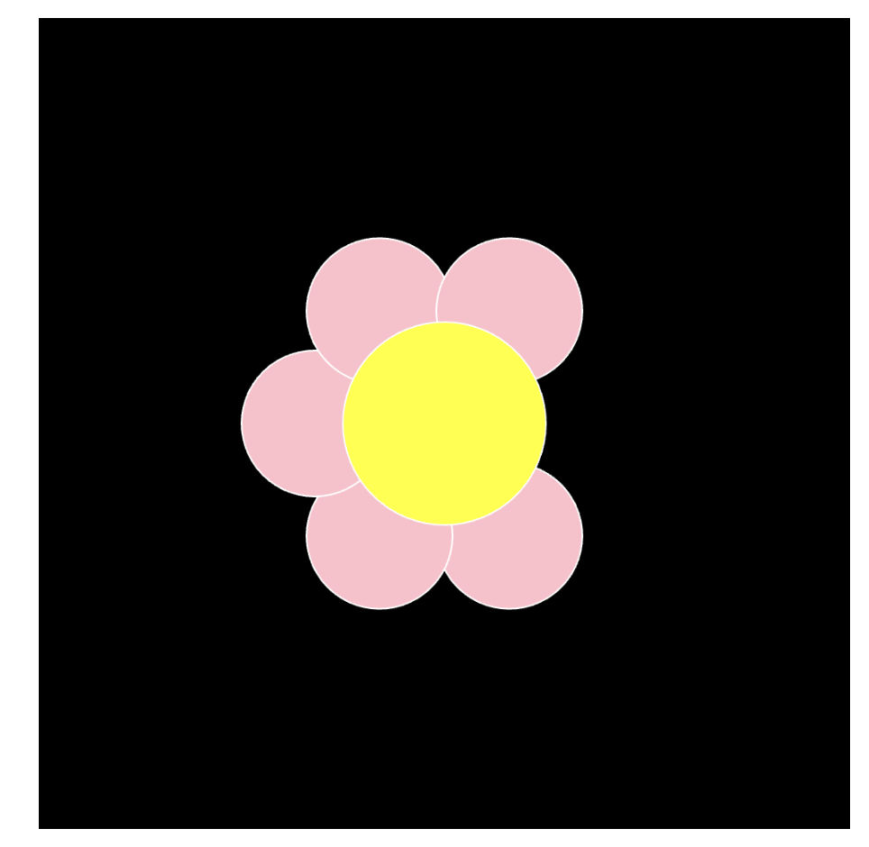
> - [LINK TO PROTOTYPE - 3 FUNCTIONS](TOPICS/PROTOTYPING/Functions_Prototypes/functions_p3/)

### FRIDAY | NOVEMBER 6, 2026
This week I made three prototypes to help develop what we learnt on arrays. I made multiple flowers whose petals fall when clicked (refactored and improved code from last week), a fortune orb that shakes and gives random answers, and bubbles that keep rising while I pop them.

The thing that surprised me the most was how much simpler my flower became. In my functions prototype I had petal1 to petal6 written out by hand, with six update calls, six draw calls and six if blocks, which was a lot. Once I stored the petals in one petals array, two short 'for loops' did all of it so much easier. When I added two more flowers, I didn’t have to change the loops at all, even though there were suddenly 18 petals.

Something I found cool is that an array can grow while the program is running. In Bubble Rain, I used a timer which calls on a function that uses .push() to add a new bubble every 0.3 seconds, and the loop picks each one up automatically. I think it made the sketch feel alive in a way my earlier work didn’t.

One of the challenges I encourntered was the index. In my fortune orb, I had the condition backwards, so the index reset to 0 on every click and the message never changed. Working out that the last position is fortunes.length - 1, because counting starts at 0, helped make it click a bit more to me. I did also use the code from class to also help with my understanding of this as we did something similar with index.

Prototypes:
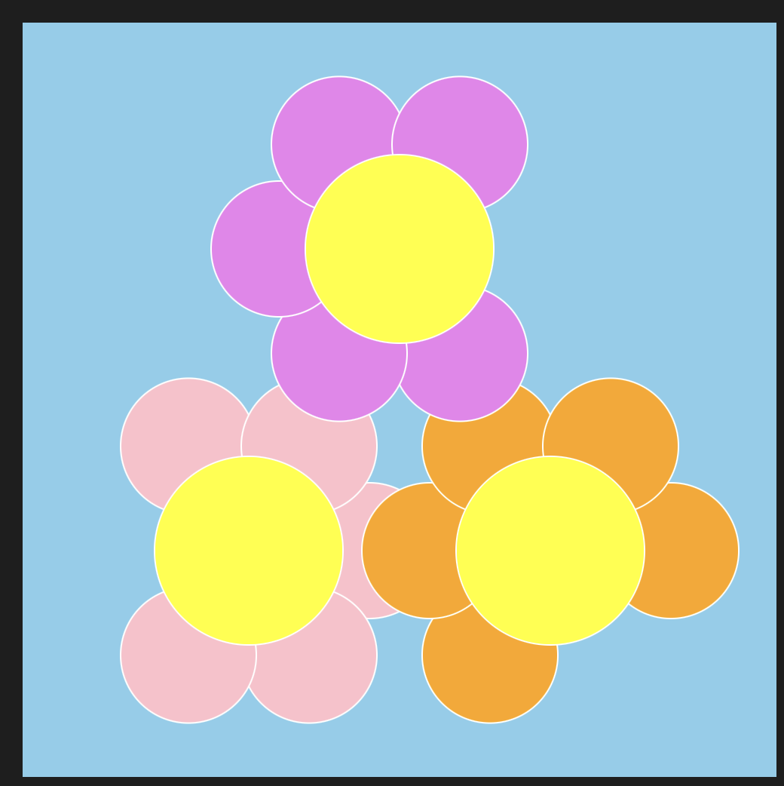
> - [LINK TO PROTOTYPE - 1 ARRAYS](TOPICS/PROTOTYPING/Arrays_Prototypes/arrays_p1/)

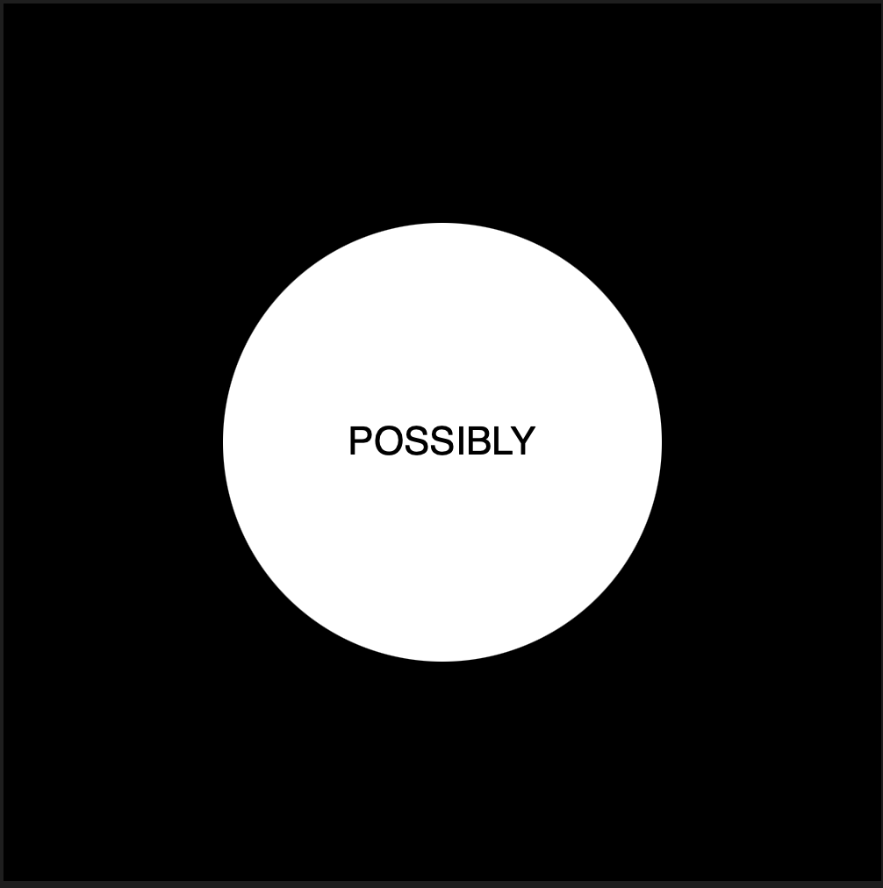
> - [LINK TO PROTOTYPE - 2 ARRAYS](TOPICS/PROTOTYPING/Arrays_Prototypes/arrays_p2/)

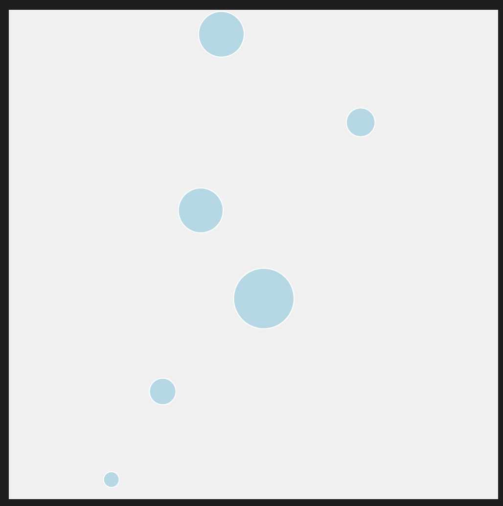
> - [LINK TO PROTOTYPE - 3 ARRAYS](TOPICS/PROTOTYPING/Arrays_Prototypes/arrays_p3/)

